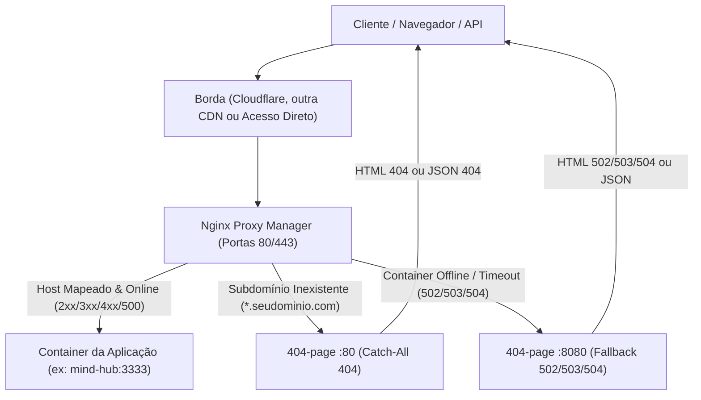

# Guia Completo de Configuração com Nginx Proxy Manager (NPM)

Este guia detalha todo o processo para colocar o **404-page** em produção — desde subir ou clonar o container até configurar o **Nginx Proxy Manager (NPM)** para cobrir subdomínios inexistentes (`404`), containers offline/parados (`502`), manutenção (`503`), timeouts (`504`) e respostas JSON para APIs.

> [!NOTE]
> **Independência da Camada de Borda:** Esta solução foi projetada especificamente para rodar em conjunto com o **Nginx Proxy Manager (NPM)** como proxy reverso. A camada de borda à frente do NPM é **indiferente** — funciona perfeitamente atrás da **Cloudflare**, outra CDN/WAF, Load Balancer ou com exposição direta nas portas `80`/`443`.
>
> Quando o tráfego passa pela Cloudflare (plano Free), o container detecta automaticamente o cabeçalho `CF-Ray` e devolve HTTP `503 Service Temporarily Unavailable` (mantendo a UI do código real `502`/`504`) para impedir que a Cloudflare substitua sua página customizada pela tela genérica de erro dela.

---

## Visão Geral da Arquitetura



### Por que duas portas (`80` e `8080`)?
* **Porta `80` (Catch-All 404):** Recebe o tráfego do host coringa (`*.seudominio.com`). Sempre responde `404 Not Found` e **ignora** qualquer cabeçalho `X-Error-Code` enviado pelo cliente, impedindo que usuários mal-intencionados forjem telas de `502/503/504`.
* **Porta `8080` (Fallback de Upstream):** Acessível apenas internamente na rede Docker compartilhada (`proxy-net`). Recebe apenas desvios internos feitos pelo NPM quando um container real falha (`502`, `503` ou `504`), lendo o cabeçalho `X-Error-Code` injetado pelo próprio NPM.

---

## Pré-requisitos

1. **Docker** e **Docker Compose** instalados no servidor.
2. **Nginx Proxy Manager (NPM)** rodando em container Docker.
3. Uma rede Docker externa compartilhada entre o NPM e os containers expostos (neste guia usaremos `proxy-net`). Caso ainda não exista:
   ```bash
   docker network create proxy-net
   ```
   Certifique-se de que o container do NPM também esteja conectado à rede `proxy-net`.

---

## Passo 1: Subir o Container `404-page`

Escolha **uma** das duas opções abaixo conforme sua necessidade.

### Opção A: Usando a Imagem Oficial Pré-compilada (GHCR) — *Recomendado*

Ideal se os links padrão ou a imagem oficial já atendem ao seu cenário (deploy rápido, sem compilação no servidor).

1. Crie um diretório para a stack no servidor (ex: `/srv/docker/404-page`):
   ```bash
   mkdir -p /srv/docker/404-page
   cd /srv/docker/404-page
   ```
2. Crie o arquivo `compose.yml`:
   ```yaml
   services:
     404-page:
       image: ghcr.io/luizgdpulz/404-page:latest
       container_name: 404-page
       restart: unless-stopped
       security_opt:
         - no-new-privileges:true
       expose:
         - "80"
         - "8080"
       networks:
         - proxy-net

   networks:
     proxy-net:
       external: true
   ```
3. Suba o container:
   ```bash
   docker compose up -d
   ```

---

### Opção B: Clonando o Repositório para Customizar Links e Textos (Build Próprio)

Como a aplicação é compilada de forma **100% estática** pelo Astro (`build-time`), a customização de links (`PORTFOLIO_URL`, `GITHUB_URL`) e do Easter Egg é feita no momento do build da imagem.

1. Clone o repositório:
   ```bash
   git clone https://github.com/luizGDpulz/404-page.git
   cd 404-page
   ```
2. Crie o `.env` a partir do exemplo e edite suas variáveis:
   ```bash
   cp .env.example .env
   nano .env
   ```
   > **Dica:** Para ocultar um botão, deixe a URL vazia (ex: `PORTFOLIO_URL=`). Se `PORTFOLIO_URL` e `GITHUB_URL` ficarem vazios, a seção inteira de links é removida do HTML.
3. Faça o build da imagem passando as variáveis do `.env`:
   ```bash
   set -a && source .env && set +a
   docker build \
     --build-arg PORTFOLIO_URL="$PORTFOLIO_URL" \
     --build-arg PORTFOLIO_LABEL="$PORTFOLIO_LABEL" \
     --build-arg GITHUB_URL="$GITHUB_URL" \
     --build-arg GITHUB_LABEL="$GITHUB_LABEL" \
     --build-arg HACKER_TRIGGER_TEXT="$HACKER_TRIGGER_TEXT" \
     --build-arg HACKER_EMOJI="$HACKER_EMOJI" \
     --build-arg HACKER_MESSAGE="$HACKER_MESSAGE" \
     --build-arg HACKER_IMAGE_URL="$HACKER_IMAGE_URL" \
     -t 404-page:custom .
   ```
4. Suba o container conectado à rede `proxy-net` (ou ajuste `image: 404-page:custom` no `docker-compose.yml`):
   ```bash
   docker run -d \
     --name 404-page \
     --restart unless-stopped \
     --security-opt no-new-privileges:true \
     --network proxy-net \
     404-page:custom
   ```

Verifique se o container está saudável (`healthy`):
```bash
docker ps --filter "name=404-page"
```

---

## Passo 2: Configurar o Host Coringa (`404`) no NPM

Este host captura qualquer subdomínio inexistente (`qualquercoisa.seudominio.com`) que chegue ao NPM.

1. Acesse o painel administrativo do **Nginx Proxy Manager**.
2. Vá em **Hosts $\rightarrow$ Proxy Hosts $\rightarrow$ Add Proxy Host**.
3. Na aba **Details**, preencha:
   * **Domain Names:** `*.seudominio.com` *(substitua pelo seu domínio; pressione Enter após digitar)*
   * **Scheme:** `http`
   * **Forward Hostname / IP:** `404-page`
   * **Forward Port:** `80`
   * **Cache Assets:** Desmarcado
   * **Block Common Exploits:** Marcado
   * **Websockets Support:** Desmarcado
4. Na aba **SSL**:
   * Selecione seu certificado **Wildcard** (ex: Let's Encrypt DNS Challenge ou Cloudflare Origin Certificate para `*.seudominio.com`).
   * **Force SSL:** Marcado
   * **HTTP/2 Support:** Marcado
   * **HSTS Enabled:** Opcional (recomendado se todo o domínio usar HTTPS)
5. Clique em **Save**.

---

## Passo 3: Configurar Interceptação Global de Containers Offline (`502 / 503 / 504`)

Para que **todos** os serviços cadastrados no NPM exibam automaticamente a tela de contingência (`502 Offline`, `503 Manutenção` ou `504 Timeout`) quando o respectivo container estiver parado ou inacessível, usamos o ponto de extensão nativo do NPM em `/data/nginx/custom/`.

Todo `proxy_host/*.conf` gerado pelo NPM inclui automaticamente o arquivo `/data/nginx/custom/server_proxy.conf` dentro do bloco `server { ... }`.

1. Localize a pasta de dados montada no `/data` do seu container NPM (ex: `/srv/docker/npm/data/nginx/custom/`).
2. Crie o arquivo `fallback_proxy.conf` dentro dessa pasta (veja o template em [`docker/npm/fallback_proxy.conf`](../docker/npm/fallback_proxy.conf)):
   ```nginx
   # Encaminha internamente para a porta 8080 (fallback status-aware) do container 404-page
   proxy_intercept_errors off;
   set $fallback_upstream "http://404-page:8080";
   proxy_pass $fallback_upstream$request_uri;
   proxy_set_header Host $host;
   proxy_set_header X-Error-Code $npm_error_code;
   proxy_set_header X-Forwarded-Scheme $scheme;
   proxy_set_header X-Forwarded-Proto  $scheme;
   proxy_set_header X-Forwarded-For    $proxy_add_x_forwarded_for;
   proxy_set_header X-Real-IP          $remote_addr;
   ```
3. Crie ou atualize o arquivo `server_proxy.conf` na mesma pasta (veja o template em [`docker/npm/server_proxy.conf`](../docker/npm/server_proxy.conf)):
   ```nginx
   # Descomente a linha abaixo caso utilize Cloudflare na borda para preservar o IP real do cliente
   # real_ip_header CF-Connecting-IP;

   # Intercepta falhas de gateway quando o container upstream estiver parado, em manutenção ou com timeout
   proxy_intercept_errors on;
   error_page 502 = @fallback_502;
   error_page 503 = @fallback_503;
   error_page 504 = @fallback_504;

   location @fallback_502 {
       set $npm_error_code "502";
       include /data/nginx/custom/fallback_proxy.conf;
   }

   location @fallback_503 {
       set $npm_error_code "503";
       include /data/nginx/custom/fallback_proxy.conf;
   }

   location @fallback_504 {
       set $npm_error_code "504";
       include /data/nginx/custom/fallback_proxy.conf;
   }
   ```
   > **Por que não interceptamos `404` ou `500` aqui?**
   > Porque suas aplicações ativas já possuem suas próprias rotas `404` (inclusive APIs REST que retornam JSON) e respostas de erro interno `500`. Interceptar apenas `502`, `503` e `504` garante que o fallback só atue quando o container de destino estiver **fora do ar, reiniciando ou travado**.

4. Valide a sintaxe do Nginx dentro do container do NPM e recarregue sem derrubar conexões:
   ```bash
   docker exec npm nginx -t
   docker exec npm nginx -s reload
   ```
   *(Substitua `npm` pelo nome real do seu container do Nginx Proxy Manager, se diferente).*

---

## Passo 4 (Opcional): Configurar o *Default Site* no NPM

Se alguém acessar o IP público do servidor diretamente ou apontar um domínio não coberto pelo `*.seudominio.com`:

1. No painel do NPM, vá em **Settings $\rightarrow$ Default Site**.
2. Caso queira que também caia na sua página 404 customizada, selecione **Redirect** ou **404 Page** conforme sua preferência (por padrão o NPM retorna um 404 simples no Default Site).

---

## Passo 5: Validação e Testes (`curl`)

Após concluir os passos, valide cada cenário diretamente via terminal:

### 1. Subdomínio Inexistente (`404`)
```bash
curl -i https://naoexiste.seudominio.com/
```
* **Esperado:** Status `HTTP/2 404`, `<title>404 — Página não encontrada</title>`.

### 2. Host Cadastrado no NPM com Container Parado (`502`)
Pare temporariamente um container de teste (ex: `docker stop meu-app`) e teste:
```bash
curl -i https://meu-app.seudominio.com/
```
* **Sem Cloudflare na borda:** Status `HTTP/2 502`, `<title>502 — Serviço temporariamente offline</title>`.
* **Com Cloudflare na borda:** Status `HTTP/2 503` (com `Retry-After: 30`), `<title>502 — Serviço temporariamente offline</title>` (bypass limpo da tela cinza da Cloudflare).

### 3. Assets Estáticos da Página de Erro (`200 OK`)
Verifique se o CSS e o favicon carregam normalmente mesmo quando o host de destino está offline:
```bash
curl -I https://meu-app.seudominio.com/favicon.svg
```
* **Esperado:** `HTTP/2 200` (se retornar `502`/`503`, o navegador não aplicará o estilo da página).

### 4. Negociação de Conteúdo para APIs (`Accept: application/json`)
```bash
curl -i -H "Accept: application/json" https://meu-app.seudominio.com/api/health
```
* **Esperado:** `Content-Type: application/json` e corpo:
  ```json
  {"error":"bad_gateway","code":502,"message":"The upstream service is currently offline or unreachable."}
  ```

### 5. Proteção Anti-Spoofing na Porta `80`
```bash
curl -i -H "X-Error-Code: 502" https://naoexiste.seudominio.com/
```
* **Esperado:** Continua respondendo `404 — Página não encontrada` (a porta `80` ignora `X-Error-Code`).

---

## Troubleshooting

* **`Permission denied` ao criar arquivos em `/srv/docker/npm/data/nginx/custom/`:**
  O processo do NPM roda como `root` dentro do container e cria a pasta pertencente ao `root`. Use `sudo` ao criar/editar `server_proxy.conf` e `fallback_proxy.conf`.
* **`404-page could not be resolved` nos logs de erro do NPM:**
  Os containers `npm` e `404-page` não estão na mesma rede Docker. Conecte ambos à rede `proxy-net` (`docker network connect proxy-net npm`).
* **Cloudflare ainda exibe a tela padrão de `502 Bad Gateway`:**
  1. Confirme que `fallback_proxy.conf` aponta para `http://404-page:8080` (e não `:80`).
  2. Confirme que `docker exec npm nginx -t` passou e `docker exec npm nginx -s reload` foi executado após salvar os arquivos.
  3. Verifique nos logs do NPM (`data/logs/proxy-host-<id>_error.log`) se o hostname do container `404-page` está resolvendo corretamente.
* **Erro 500 interno após editar `server_proxy.conf`:**
  Rode `docker exec npm nginx -t` para identificar imediatamente a linha com erro de sintaxe ou caminho incorreto do `include`.
